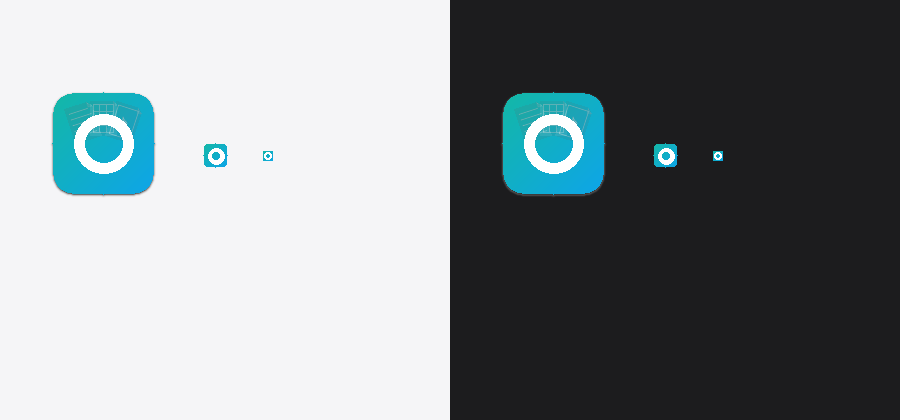
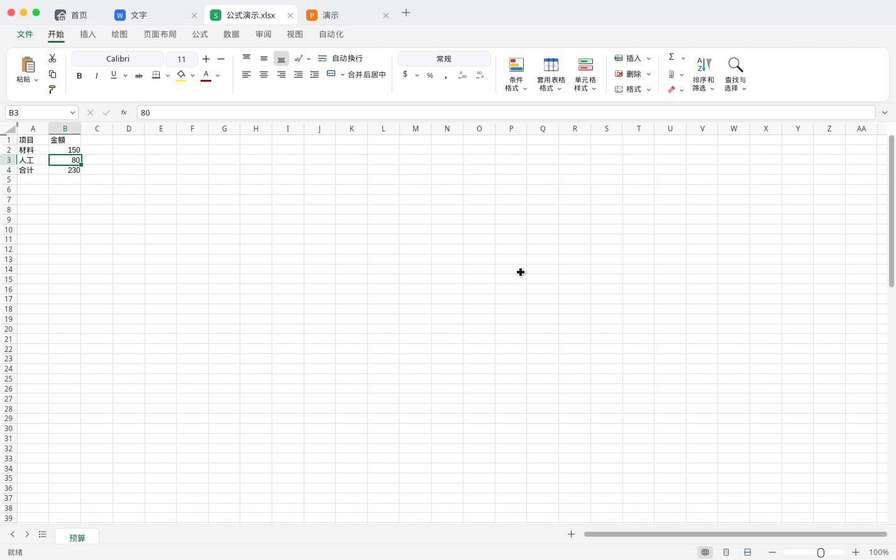
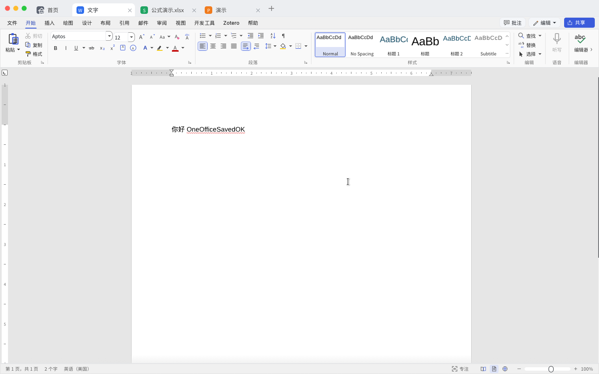
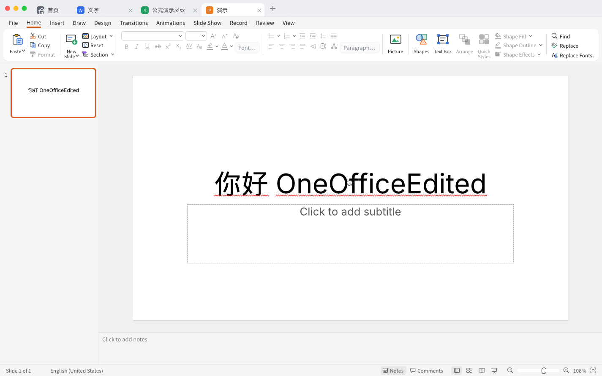

# OneOffice

一个窗口里的文字、表格和演示。编辑来自 [storytold](https://github.com/storytold) 的 [wordcraft](https://github.com/storytold/wordcraft)、[gridcraft](https://github.com/storytold/gridcraft) 和 [deckcraft](https://github.com/storytold/deckcraft)。OneOffice 是把这三家放在一起的主程序，主要做一体窗口和中文体验。界面以中文为主，用 Rust 和 egui 写成，文件留在你自己的电脑上。

<p align="center">
  <a href="LICENSE-MIT"></a>
  
  <a href="https://github.com/snjgzz/oneoffice/actions/workflows/ci.yml"></a>
</p>

<p align="center">
  <a href="#优势">优势</a> ·
  <a href="#功能">功能</a> ·
  <a href="#快速开始">快速开始</a> ·
  <a href="#系统要求">系统要求</a> ·
  <a href="#已知限制">已知限制</a> ·
  <a href="#参与贡献">贡献</a> ·
  <a href="#许可证与归属">许可证</a>
</p>

In short: one program that puts storytold wordcraft, gridcraft and deckcraft in a single window, with a mainly Chinese interface and no ads. The release binary is about 130 MB with media codecs included, not a few-megabyte app. It is not a LibreOffice-level suite, and it is not an official WPS, Microsoft or storytold product.

<p align="center">
  
  <br>
  <sub>应用图标。源文件和打进 <code>.app</code> 的方法在 <a href="packaging/macos/README.md"><code>packaging/macos</code></a>。</sub>
</p>

<p align="center">
  
  <br>
  <sub>Linux 上从源码跑起来的窗口：文字、表格、演示三个标签同时开着。</sub>
</p>

## 优势

对照的是常见商业办公套件（例如 WPS），不是功能对等。PDF、云协作、模板和会员那些能力，这里没有。格式能覆盖多少，见 [已知限制](#已知限制)。

- **无广告。** 界面上没有推广，也不要求登录。许可证是 MIT OR Apache-2.0。金山办公已在 2023-12-20 关闭 WPS 国内个人版的第三方商业广告（[IT之家](https://www.ithome.com/0/740/399.htm)）；2025-07-22 他们在社区说明，界面仍会展示 WPS 自己的新功能和付费优惠（[讨论帖](https://bbs.wps.cn/topic/57864)）。OneOffice 没有这一层。
- **体积相对完整套件更小，但不是几 MB。** release 二进制大约 130 MB，音视频解码器算在里面。腾讯软件中心列出的 Windows 版 WPS Office 12.1.0.28505 安装包是 292.66 MB（页面更新时间 2026-09-01，[软件详情](https://pc.qq.com/detail/15/detail_1215.html)，2026-10-15 查阅）。WPS 官网繁体下载页写的下载大小是 5.1 MB、硬盘空间 200 MB 以上（[页面](https://zh-hant.wps.com/office/windows/)，2026-10-15 查阅）。5.1 MB 是在线安装引导，不是装好以后的体积。
- **一个原生进程。** 打开的就是这个程序，没有另装开机启动或后台组件。官方帮助里能查到关闭「办公助手」开机自启的步骤，页面标明的是 WPS Office 2019 PC 个人版（[学堂](https://www.wps.cn/learning/room/d/315960)）。没有和 WPS 或 Microsoft Office 做过速度跑分，所以不写快几倍。

## 功能

- **三种文档，一个窗口。** 文字、表格、演示各自一个标签，可以一起开着，用 ⌘1–9 切换。每种都能打开、编辑、保存。
- **界面以中文为主。** 文字和表格的功能区是中文；演示的功能区目前仍是英文，幻灯片里的中文可以正常显示。
- **常见 Office 文件。** 打开 `.doc`、`.docx`、`.xlsx`、`.xlsm`、`.xls`、`.xlsb`、`.ods`、`.pptx`。旧格式和新格式的保存方式不一样，见 [已知限制](#已知限制)。
- **最近文件在本机。** 从打开对话框进来的文件记在配置目录的 `recent.json` 里，没有账号。

<table>
<tr>
<td width="50%" valign="top">

<p align="center"><sub>文字。功能区是中文。</sub></p>
</td>
<td width="50%" valign="top">

<p align="center"><sub>演示。功能区仍是英文。</sub></p>
</td>
</tr>
</table>

标签里的文字、表格和演示就是上面三个上游项目。OneOffice 提供窗口、标签和最近文件，不替代它们各自的仓库。

## 快速开始

需要 Rust 1.95 或更新。[rustup](https://rustup.rs/) 的 stable 即可。

```sh
git clone --recurse-submodules https://github.com/snjgzz/oneoffice
cd oneoffice
tools/apply-gridcraft-patch.sh
tools/apply-wordcraft-patch.sh
tools/apply-deckcraft-patch.sh
cargo run -p oneoffice
```

克隆时如果没带上子模块，先补一次再打补丁：

```sh
git submodule update --init --recursive
tools/apply-gridcraft-patch.sh
tools/apply-wordcraft-patch.sh
tools/apply-deckcraft-patch.sh
```

三个脚本会改 `vendor/` 里的工作区，让上游编辑器画在这个窗口里。不打补丁，工程编不过。脚本可以重复执行。

打开一个已有文件：

```sh
cargo run -p oneoffice -- ~/Documents/预算.xlsx
```

要一个去掉调试信息的二进制：

```sh
cargo build --release -p oneoffice
```

产物在 `target/release/oneoffice`（Windows 上是 `oneoffice.exe`）。演示用的音视频解码器会一起编进去，这个文件大约 130 MB。

### 安装包

推送 `v*` tag 之后，[Release workflow](.github/workflows/release.yml) 会编两个未签名的包，并挂到 [GitHub Release](https://github.com/snjgzz/oneoffice/releases) 上：

- macOS Apple Silicon：`OneOffice-<版本>-macos-aarch64.dmg`，里面是 `OneOffice.app`，图标用 [`packaging/macos/OneOffice.icns`](packaging/macos/OneOffice.icns)。
- Windows x86_64：`OneOffice-<版本>-windows-x86_64-setup.exe`。这是 NSIS 安装程序，装到 `C:\Program Files\OneOffice`，开始菜单有快捷方式，没有开机启动项。

```sh
git tag v0.1.0
git push origin v0.1.0
```

也可以在 Actions 页面手动运行 Release。填写 tag（例如 `v0.1.0`）时，会对这次选中的提交创建或更新 GitHub Release。tag 留空时，只在这次 Actions 运行里保留产物。

本机打 macOS 包需要已经编过 release，并且本机有 `hdiutil`：

```sh
packaging/macos/package-dmg.sh v0.1.0
```

### 未签名

这些 `.dmg`、`.app` 和 Windows 安装程序都没有代码签名。Release 说明用的是同一段话，见 [`packaging/RELEASE_NOTES.md`](packaging/RELEASE_NOTES.md)。

macOS 上第一次打开，Gatekeeper 通常会拦住。在 Finder 里按住 Control 点按 OneOffice（或右键），选择「打开」，再确认一次。

Windows 上 SmartScreen 可能提示未知发布者。安装程序会请求管理员权限，因为它写入 `C:\Program Files\OneOffice`。

自己组装 `.app` 时，图标步骤在 [`packaging/macos/README.md`](packaging/macos/README.md)。

## 系统要求

- **Rust** 1.95 或更新（edition 2024）。仓库里的 `rust-toolchain.toml` 用的是 stable。
- **macOS**：主要在 Apple Silicon 上开发和打包。Intel Mac 用同一套代码可以编，但不是平时验证的机器。
- **Linux** 能编过、能跑。系统标题栏会关掉，窗口按钮画在标签栏左侧。编译前安装：

```sh
sudo apt-get install -y pkg-config libgtk-3-dev libxcb-render0-dev libxcb-shape0-dev \
  libxcb-xfixes0-dev libxkbcommon-dev libxkbcommon-x11-0 libssl-dev libwayland-dev
```

**Windows。** Release 里的安装包是 x86_64，在 GitHub 的 `windows-latest` 上编译。日常开发没有把 Windows 当作验证机器。

## 快捷键

修饰键在 macOS 上是 ⌘，在 Linux 上是 Ctrl。⌘S / Ctrl+S 留给当前文档保存，主程序不拦截。

| 按键 | 作用 |
| --- | --- |
| ⌘T | 回到首页 |
| ⌘W | 关闭当前文档标签（首页关不掉） |
| ⌘1–9 | 切换标签，1 是首页 |
| ⌘O | 打开文件 |
| ⌘K | 聚焦搜索 |

首页上双击最近文件会再打开它。右键可以打开所在文件夹，或从列表里移除。

最近列表的位置：

- macOS：`~/Library/Application Support/OneOffice/recent.json`
- Linux：`$XDG_CONFIG_HOME/OneOffice/recent.json`，未设置时是 `~/.config/OneOffice/recent.json`

## 已知限制

- 格式兼容远不到 LibreOffice 或桌面 Office。复杂排版、宏、修订和一部分对象会丢，或者直接打不开。
- `.doc` 可以读，保存时写成 `.docx`。`.xls`、`.xlsb`、`.ods` 可以导入，保存时写成 `.xlsx`。
- 演示的功能区、菜单和状态栏仍是英文。
- 界面字体是 Noto Sans SC 的 GB2312 子集，子集以外的汉字会缺字形。
- 同一类文档开着多个标签时，少数对话框或浮层可能互相干扰。
- 没有代码签名。GitHub Release 上的 macOS `.dmg` 和 Windows 安装程序也未签名，第一次打开时系统会提示。

## 仓库结构

```
crates/shell       可执行文件 oneoffice，以及同名库
vendor/wordcraft   storytold/wordcraft，固定在某一提交
vendor/gridcraft   storytold/gridcraft，固定在某一提交
vendor/deckcraft   storytold/deckcraft，固定在某一提交
patches/           把三个编辑器嵌进主程序的补丁
tools/             打补丁的脚本，以及字体子集工具
packaging/macos/   应用图标，以及未签名 .dmg 的打包脚本
packaging/windows/ NSIS 安装脚本（x86_64）
.github/workflows/ 持续集成，以及按 tag 发布安装包
docs/images/       本页用的界面截图和图标预览
```

三个上游仓库不加入本仓库的 workspace。怎么嵌、怎么跟着上游改，写在 [`patches/README.md`](patches/README.md)。

## 参与贡献

问题和改动请开 [Issue](https://github.com/snjgzz/oneoffice/issues) 或 Pull Request。

改标签里的编辑器之前，先看 [`patches/README.md`](patches/README.md)。补丁打在子模块的工作区上，不要把打过补丁的子模块提交成上游仓库里不存在的提交。

## 路线图

已经有的：主窗口，文字、表格、演示同时开着，以及上面列出的那些 Office 文件的打开和保存。

接着会做的，不排期：

- 演示界面改成中文。
- 如果发布体积碍事，再把音视频解码器做成可选功能。
- 用更多真实文件试打开和保存，把丢内容、打不开的情况记下来，而不是先宣称兼容某一整套格式。

## 许可证与归属

代码以 MIT OR Apache-2.0 双许可发布，见 [`LICENSE-MIT`](LICENSE-MIT) 和 [`LICENSE-APACHE`](LICENSE-APACHE)。

OneOffice 不隶属于 WPS、Microsoft 或 storytold，也不使用它们或 ArtCraft 的名称做背书。

文字、表格和演示的编辑来自上面三个子模块，版权和 MIT OR Apache-2.0 许可证留在各自仓库。固定的提交和补丁名写在 [`NOTICE`](NOTICE)。

界面字体是 Noto Sans SC Regular 2.004 的子集，单独使用 SIL Open Font License 1.1。版权归 Adobe，保留字体名 Source。许可证全文在 [`crates/shell/assets/fonts/OFL.txt`](crates/shell/assets/fonts/OFL.txt)。
